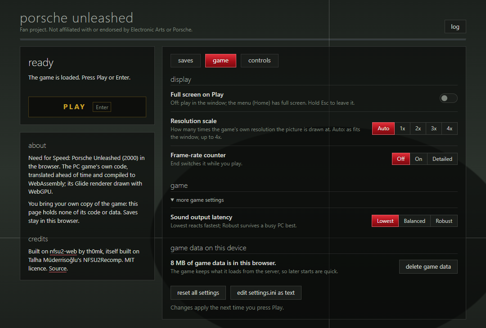

# Need for Speed: Porsche Unleashed in the browser

A fan project that runs the PC game *Need for Speed: Porsche Unleashed* (2000, v3.5) in Google Chrome. The game's
x86 code is translated to C ahead of time and compiled to WebAssembly. The game's 3dfx Glide 3 renderer runs on
WebGPU, the sound on Web Audio. You bring your own copy of the game.

> Not affiliated with or endorsed by Electronic Arts or Porsche. This repository contains none of the game's code or
> data.



## Status

Work in progress. Boot, profiles, menus, the 3D garage and a quick race (Cote d'Azur, with opponents, HUD and
sound) run at about 60 fps in Chrome. Keyboard and mouse work. Not tested yet: a race to the finish, the other tracks
and modes (career, knockout, factory driver), replays, gamepads and wheels, multiplayer, Firefox and Safari.

## What you need

- **The game:** your own PC copy, version 3.5, with this exact `Porsche.exe` (other versions will not work):
  2,129,965 bytes, SHA-256 `96af10308b12840c7a0770ff87443a8516c3b756f34d2bc276988cc64f56b98c`,
  and `Drivers/voodoo2z.dll` (the Glide driver): 135,168 bytes,
  SHA-256 `ddf9e6a6fa7b0c783d993e2a7b82ed3cde43ff818790fe671b3a108041ff01db`.
- **To build:** Linux or WSL 2 on Windows, Python 3, Node.js 20 or newer, and
  [wasi-sdk](https://github.com/WebAssembly/wasi-sdk/releases) 34 for x86_64 Linux unpacked into `deps/`.
  The optional native headless build also needs clang.
- **To play:** the latest Google Chrome (WebGPU) on a computer.

## Build

```sh
python3 -m venv .venv && .venv/bin/pip install -r requirements.txt
(cd web && npm ci)                                               # esbuild for the page

tools/porsche_lift.sh "/path/to/Porsche Unleashed/Porsche.exe"   # the game's code to C (gen/all)
tools/porsche_glide_lift.sh "/path/to/Porsche Unleashed/Drivers/voodoo2z.dll"   # the Glide driver (gen/server)
tools/porsche_web_build.sh                                       # out/web/porsche.wasm
node web-porsche/build.mjs                                       # the page (web-porsche/dist)
```

The generated C and the compiled module are made from the game, so they are never committed (`.gitignore`).
`RENDERER=sw tools/porsche_web_build.sh` builds a software-rendered module instead (`out/web/porsche-sw.wasm`,
open the page with `?wasm=/porsche-sw.wasm`). `tools/porsche_native.sh` builds a native headless Linux binary
(`out/native/porsche_boot`) for debugging.

## Play

```sh
node web-porsche/server.mjs --data "/path/to/Porsche Unleashed" --port 8080
```

Open **http://localhost:8080/** in Chrome and press **Play** (or Enter). The game folder is only read.

- **Play** shows what the page is doing: downloading the game, ready, running, or a problem with what to do about
  it. One browser runs one game: a second tab says the game is open elsewhere and takes over when the first closes.
- **Saves:** the players the game has, a backup of your saves as one zip and its restore, and your screenshots.
  Saves stay in this browser (they are not in the game folder).
- **Game:** full screen on Play, the resolution the picture is drawn at (Auto comes down by itself when the
  graphics card cannot keep up), the frame-rate counter, the sound's output latency, and the game data this
  browser keeps. Each change applies at the next Play; "Edit settings.ini as text"
  shows the file behind them.
- **Controls:** the game's keys, as its own Options show them, and the page's keys.

While you play: **Home** opens the page's menu (full screen, frame-rate counter, controls, log, **Quit game**),
**End** switches the frame-rate counter, **Insert** saves a screenshot, and holding **Esc** leaves full screen.
The game uses F1 to F12 itself. The game pauses while its tab is in the background.

For development, the page's address takes `?env=NAME=value` (a runtime variable, for example `PORSCHE_PROF=1`: an
import profile every 10 s, `NFSU2_KEY_LOG=1`: a key log, `NFSU2_WATCHDOG=20`: a stall report after 20 s),
`?scale=N` (the picture at N times the game's resolution), `?wasm=` (another module), `?probe=mouse` (after
22 s in the first menu it times the frames and the mouse's delay into the log) and `?probe=gpu` (what the
graphics card needs for a frame at each scale).

## How it works

- **`tools/`:** a Python lifter (Capstone) turns every function of `Porsche.exe` and `voodoo2z.dll` into C.
- **`runtime/`:** Windows, DirectSound and DirectInput, reimplemented. `runtime/porsche/` holds Glide 3 (state,
  texture memory, LFB, a software rasterizer), the game's extra Win32 calls, `gimme.dll`'s image converter and the
  overrides of a few game functions. `runtime/porsche_web/` is the browser entry point and the WebGPU command
  recorder, `runtime/web/` the browser audio and input, `runtime/linux/` the native headless entry point.
- **`web-porsche/`:** the page. It runs the game's threads as workers on one shared memory, draws the Glide
  commands with WebGPU (one WGSL uber-shader) and plays sound through an AudioWorklet; `src/main.ts` is the start
  page's shell and `src/game.ts` one run of the game. `web/src/` holds the shared host workers, audio and input it
  uses. `server.mjs` serves the page, the module and your game folder.
- **`porsche-dev/`:** the development scripts (build, unit tests of the page, debugging with gdb, disassembly, log
  tools), the runtime patches (`rt/patch_rt*.py`), the page's sources of truth (`web-porsche/`) and the notes
  (`NOTES.md`): root causes fixed so far, how to debug a freeze.

## Credits

Built on [nfsu2-web](https://github.com/th0mk/nfsu2-web) by th0mk (Need for Speed: Underground 2 in the browser),
itself built on the recompiler and runtime of Talha Müderrisoğlu (NFSU2Recomp). MIT licence, see [LICENSE](LICENSE).
